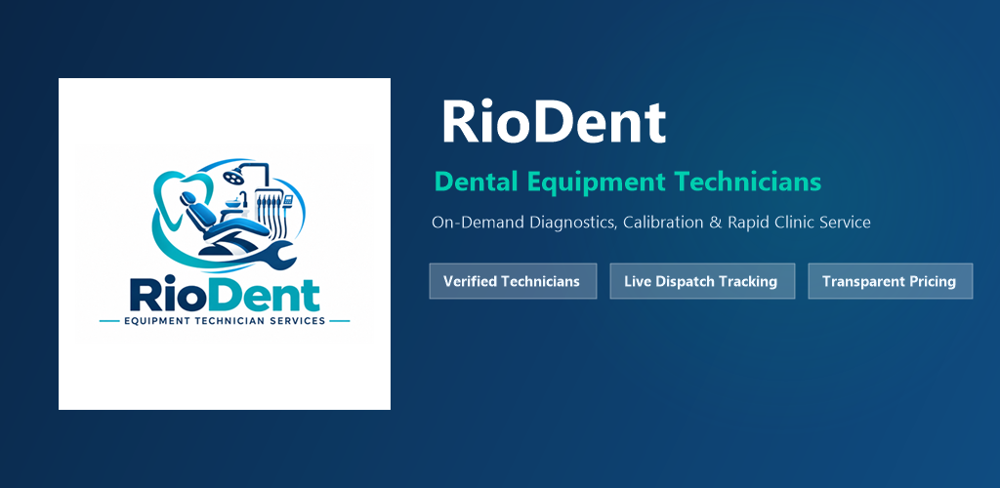

# RioDent – Dental Equipment Services & Technician Management Platform



RioDent is an enterprise-grade mobile and web platform built with Flutter and Firebase that connects dental clinics with certified dental equipment repair and maintenance technicians across Hyderabad, Telangana.

* **For Dental Clinics / Doctors**: On-demand emergency breakdown and scheduled maintenance booking with zero diagnostic fees, dynamic Hyderabad slot scheduling, real-time ticket tracking, and self-service ticket modification.
* **For Field Technicians**: Qualified high-intent repair jobs with verified clinic locations, equipment details, and live dispatch routing.
* **For Administrators**: Real-time operations console featuring live KPI metric counters, dynamic booking queues, clinic directories with one-tap calling, field technician roster management, and inline equipment category administration.

---

## 🚀 Live Deployments & Environments

| Environment | Purpose | Firebase Project ID | Region | Status |
| :--- | :--- | :--- | :--- | :---: |
| **DEV** | Development, Testing & QA | `equip-services-dev` | `nam5` | **Live & Operational** ([Web App](https://equip-services-dev.web.app)) |
| **STAGING** | Pre-production testing | `riodent-staging` | — | **Configured** |
| **PROD** | Production Release (Google Play) | `riodent-prod` | `asia-south1` (Mumbai) | **Deployed & Ready** (`riodent-release-prod.aab`) |

> 📜 **Client Release Certificate & Test Matrix:** See [CLIENT_QA_AUDIT_AND_RELEASE_CERTIFICATE.md](CLIENT_QA_AUDIT_AND_RELEASE_CERTIFICATE.md) for the executive sign-off, all 89 test case results, and final GO verdict.  
> 📊 **Client Presentation Deck:** See [CLIENT_PRESENTATION_AND_END_TO_END_SPEC.md](CLIENT_PRESENTATION_AND_END_TO_END_SPEC.md) for the slide-by-slide end-to-end screen, button, and workflow specification.  
> 📖 **Audit & Conversation History:** See [MASTER_CONVERSATION_AND_RELEASE_LOG.md](MASTER_CONVERSATION_AND_RELEASE_LOG.md) for the complete chat history, architectural decisions, and release audit log.

---

## 🎨 Branding & Official Logo

The official RioDent brand identity incorporates:
* **Emblem**: Ergonomic dental patient chair, tooth contour in cyan/blue, overhead surgical lamp, instrument delivery tray, and precision maintenance wrench.
* **Palette**: Surgical Deep Navy (`#0A2647`), Slate Navy (`#144272`), Bright Healthcare Blue (`#205295`), Ice Blue (`#E0F2FE`), and Precision Mint/Teal (`#00CEAF`).
* **Tagline**: *"EQUIPMENT TECHNICIAN SERVICES"*
* **Source Assets**:
  * Full Horizontal Logo: `assets/images/riodent_logo.png`
  * High-Res Square App Icon: `assets/images/riodent_icon.png` (512x512)
  * Google Play Store Icon: `assets/playstore/app_icon_512x512.png`
  * Google Play Store Feature Banners: `assets/playstore/feature_graphic_1024x500.png` & `feature_graphic_1025x500.png`
  * Web Favicon & App Icons: `web/favicon.png` (64x64), `web/icons/Icon-192.png`, `web/icons/Icon-512.png`
  * Native Android Mipmaps: `android/app/src/main/res/mipmap-*` (mdpi, hdpi, xhdpi, xxhdpi, xxxhdpi)

---

## 🖥️ Desktop Web Adaptive Frame (Professional Layout)

On Firebase Hosting, when accessed via desktop or laptop browsers (screen width > 640px), the application automatically adapts into a **centered professional web frame** (`maxWidth: 580px`) with:
* Soft Slate backdrop (`#F1F5F9` in light mode, `#0F172A` in dark mode)
* Subtle drop-shadow elevation (`blurRadius: 32`) and vertical boundary borders
* Complete prevention of wide stretched mobile controls, ensuring all buttons, form fields, and navigation tabs remain proportionate, crisp, and comfortable.
* Seamless 100% full-width responsiveness on mobile viewports (≤ 640px).

---

## 📁 Comprehensive Directory Structure

```text
riodent/
├── .github/                       # GitHub configurations and workflows
│   ├── README.md                  # Internal engineering documentation
│   └── workflows/
│       └── ci.yml                 # Automated CI pipeline (analyze, test, build web)
├── android/                       # Native Android project configuration
│   └── app/
│       ├── build.gradle.kts       # Android build settings (com.riodent.riodent)
│       ├── google-services.json   # Active Firebase configuration
│       └── src/main/res/          # Launcher icons (mipmap-*)
├── assets/                        # Static application assets
│   ├── images/                    # riodent_logo.png, riodent_icon.png
│   └── playstore/                 # 512x512 app icon, 1024x500 & 1025x500 banners, screenshots
├── web/                           # Flutter Web entry point & compliance pages
│   ├── index.html                 # Web SPA bootstrap with responsive background
│   ├── favicon.png                # 64x64 RioDent favicon
│   ├── manifest.json              # PWA manifest
│   ├── privacy.html               # Hosted Privacy Policy for Play Store & Hosting
│   └── delete-account.html        # Hosted Account Deletion instructions page
├── lib/                           # Flutter application source code
│   ├── main.dart                  # App bootstrap, Firebase core init, ProviderScope
│   ├── app.dart                   # MaterialApp.router with responsive desktop frame
│   ├── firebase_options.dart      # FlutterFire multi-platform configurations
│   ├── models/                    # Immutable domain models
│   │   ├── booking_config_model.dart     # Service slots, dynamic lead time, categories
│   │   ├── technician_model.dart         # Technician profile, area, active state
│   │   ├── technician_request_model.dart # Ticket lifecycle state machine & payment
│   │   └── user_model.dart               # Doctor & Admin models with role isolation
│   ├── repositories/              # Data access layer
│   │   ├── auth_repository.dart          # Auth methods (Email, Google, Account Delete)
│   │   ├── request_repository.dart       # Single-field Firestore queries + memory sort
│   │   ├── technician_repository.dart    # Roster management & active technician queries
│   │   ├── user_repository.dart          # Doctor profiles & live count streams
│   │   └── settings_repository.dart      # Operational configuration management
│   ├── providers/                 # Riverpod reactive state management
│   │   ├── auth_providers.dart           # Current user, auth state, admin claim
│   │   ├── request_providers.dart        # Real-time requests, status counts, revenue
│   │   ├── technician_providers.dart     # Technicians stream & active count stream
│   │   ├── user_providers.dart           # Doctor directory stream & count stream
│   │   ├── settings_providers.dart       # Live booking configuration stream
│   │   └── theme_provider.dart           # Dark/Light theme mode state notifier
│   ├── router/                    # GoRouter declarative routing
│   │   └── app_router.dart               # Route guards, redirects, error handling
│   ├── screens/                   # User interface presentation layer
│   │   ├── auth/                         # Login, Register, Admin Sign-In
│   │   ├── dentist/                      # Home, Booking, Review, Submitted, Requests
│   │   ├── admin/                        # Dashboard, Dispatch, Doctors, Techs, Settings
│   │   └── profile/                      # Clinic Profile, Theme toggle, Delete Account
│   ├── theme/                     # AppTheme styling system and typography tokens
│   └── utils/                     # Validators (Phone, Pincode, Email) and Constants
├── test/                          # Comprehensive QA automated test suite (86 tests)
│   ├── admin_panel_test.dart             # 25 Positive & Negative admin panel test cases
│   ├── overflow_test.dart                # 18 Zero-overflow viewport tests (320px, 360px, 412px)
│   ├── qa_excel_test_suite_test.dart     # QA test cases (AUTH, BKG, SLT, DR, DSH)
│   ├── booking_config_test.dart          # Slot generation, lead time, deduplication
│   ├── edit_request_test.dart            # Wrong-issue and wrong-time edit permissions
│   ├── environment_test.dart             # Multi-environment resolution tests
│   ├── status_transitions_test.dart      # Ticket state machine validation
│   ├── technician_request_test.dart      # Serialization and completion mapping
│   ├── user_model_test.dart              # Privilege escalation security tests
│   └── validators_test.dart              # Indian phone, Hyderabad pincode, Email validators
├── tools/                         # Maintenance and automation scripts
│   ├── process_logo.ps1                  # Generates app icons, favicons, mipmaps from logo
│   ├── generate_playstore_assets.ps1     # Generates Play Store banners & icons
│   └── summarize_qa.py                   # QA test metrics summary script
├── firestore.indexes.json         # Composite index definitions for Cloud Firestore
├── firestore.rules                # Declarative Firestore security rules
├── storage.rules                  # Firebase Cloud Storage security rules
├── firebase.json                  # Firebase CLI configuration (Hosting, Firestore, Storage)
└── .firebaserc                    # Firebase CLI active project binding
```

---

## 🛠️ Features Implemented Till Date

### 1. Doctor & Dental Clinic Experience
* **Authentication**: Email/Password and Google Sign-In with 1-click demo access for rapid evaluation.
* **Interactive Booking Engine**:
  * **Equipment Categories**: Dynamic categories (Dental Chair Units, Autoclaves, X-Ray Units, Compressors, Scaling Units, Handpieces).
  * **Pincode Verification**: Strictly validates Hyderabad serviceable pincode prefixes (`500xxx`, `501xxx`).
  * **Smart Time Slots**: Dynamic calculation with a strict 30-minute minimum lead time for same-day bookings and bookable slots up to 7 days ahead.
  * **Problem Description**: Accepts 1 to 500 characters of medical description with zero restrictive word filters.
* **Ticket Modification (Wrong Time / Wrong Issue)**: Doctors can edit ticket details while in `NEW` or `ASSIGNED` status before a technician begins work.
* **Review & Confirmation**: Full booking breakdown screen before final submission. Eliminates route casting errors on confirmation.
* **Ticket Cancellation**: Doctor can cancel a ticket with a reason before technician dispatch, adhering to state machine safeguards.
* **Clinic Profile & Theme Support**:
  * Real-time light/dark theme toggle with persistent user preference.
  * Total service requests and completed tickets counters.
  * **Self-Service Account Deletion**: Full GDPR and Google Play Store compliant account removal (cleans Firestore user data and deletes Firebase Auth record).

### 2. Admin Operations Console
* **Real-Time KPI Dashboard**:
  * Real-time stream counters for **Registered Clinics**, **Field Technicians**, and **Total Paid Revenue** (sums completed requests only).
  * Ticket status breakdown counters (`NEW`, `ASSIGNED`, `IN_PROGRESS`, `COMPLETED`, `CANCELLED`).
  * Urgent **Needs Attention** queue.
* **Live Bookings Dispatch Queue**:
  * Filter by status tabs with instant real-time synchronization when tapping dashboard KPI cards.
  * Search tickets by clinic name, doctor, ticket ID, or equipment type.
* **Registered Clinics Directory**:
  * Displays **Clinic Name**, **Doctor Name**, **10-Digit Mobile Number** with a direct **Call** action, and **Address** with location pin.
* **Field Technician Roster Management**:
  * Add new technician with Hyderabad service area and specialization.
  * Edit technician profile details and active status.
  * **Delete Technician**: Remove technician from roster with confirmation dialog, updating the active technician count in real time.
* **Inline Equipment Category Management (Settings)**:
  * Add new equipment categories with automatic code generation and duplicate checking.
  * Rename existing categories.
  * Toggle categories active/inactive.
* **Platform Operational Policies**:
  * Dynamic Hyderabad operations support phone number.
  * Serviceable pincode prefix configuration.
  * Max days ahead for booking and max open requests per doctor.
* **Technician Assignment**:
  * Dedicated assignment modal actively watching the technician roster.
  * Direct asynchronous fallback query to prevent empty-roster errors.
  * In-modal quick registration dialog if no technicians are active.
  * Ability to advance tickets to `IN_PROGRESS`, close on behalf of doctor with whole-rupee payment validation, or cancel ticket with reason.

### 3. Backend & Database Architecture
* **Single-Field Firestore Query Architecture**: Requests queries filter on single fields in Firestore and perform chronological ordering in Dart memory, completely eliminating compound index failures.
* **Deployed Firestore Composite Indexes**: Defined in `firestore.indexes.json` and deployed to both `equip-services-dev` and `riodent-staging`.
* **Privilege Escalation Prevention**: User roles (`admin`, `dentist`) are determined by Firebase Custom Claims, preventing malicious clients from writing `role: admin` to their Firestore user document.

---

## 🧪 Comprehensive QA Test Suite (86 / 86 Tests Passing)

All 10 test suites pass with a **100% pass rate**:

```bash
flutter test
```

### Test Suite Breakdown:
1. **[admin_panel_test.dart](file:///test/admin_panel_test.dart)** (25 Tests):
   * `[POS]` Admin can assign technician when ticket is in `NEW` status.
   * `[POS]` Admin can reassign technician when ticket is in `ASSIGNED` status.
   * `[NEG]` Admin cannot assign technician when ticket is `IN_PROGRESS` (job locked).
   * `[NEG]` Admin cannot assign technician when ticket is `COMPLETED` or `CANCELLED`.
   * `[POS]` Status advances to `IN_PROGRESS` only when assigned technician is present.
   * `[NEG]` Reject advance to `IN_PROGRESS` if unassigned or still `NEW`.
   * `[POS]` Admin can close ticket on behalf with whole-rupee amount (0 to 100,000).
   * `[NEG]` Amount validator rejects negative numbers, decimals, or amounts > 100,000.
   * `[POS]` Admin can cancel ticket from `NEW`, `ASSIGNED`, or `IN_PROGRESS` with reason.
   * `[NEG]` Admin cannot cancel terminal tickets (`COMPLETED` / `CANCELLED`).
   * `[NEG]` Doctor cannot cancel ticket once technician is `IN_PROGRESS`.
   * `[POS]` Adding new equipment category creates code and label properly.
   * `[NEG]` Duplicate category codes are prevented.
   * `[POS]` Real-time KPI calculations: Revenue sums completed tickets only; deletions reflect immediately.
2. **[overflow_test.dart](file:///test/overflow_test.dart)** (18 Tests):
   * Zero-overflow viewport validation across all 6 core screens at **320x568** (iPhone SE), **360x640** (Budget Android), and **412x915** (Modern Flagship).
3. **[qa_excel_test_suite_test.dart](file:///test/qa_excel_test_suite_test.dart)** (9 Tests):
   * Auth validation (`AUTH-05`, `AUTH-08`), role isolation (`AUTH-23`, `SEC-03`), booking & address (`BKG-05` to `BKG-19`), time slots (`SLT-01` to `SLT-13`), ticket lifecycle state machine (`DR-01` to `DR-17`, `ADM-08` to `ADM-18`).
4. **[booking_config_test.dart](file:///test/booking_config_test.dart)** (5 Tests):
   * Default configuration, deduplication by code, 30-minute min lead time, slot availability.
5. **[edit_request_test.dart](file:///test/edit_request_test.dart)** (4 Tests):
   * Edit allowed in `NEW` and `ASSIGNED`; blocked in `COMPLETED`, `CANCELLED`, or `IN_PROGRESS`.
6. **[environment_test.dart](file:///test/environment_test.dart)** (3 Tests):
   * Resolution of `DEV` and `PROD` environments from `--dart-define=ENV=...`.
7. **[status_transitions_test.dart](file:///test/status_transitions_test.dart)** (4 Tests):
   * State machine transitions, terminal states (`COMPLETED`, `CANCELLED`).
8. **[technician_request_test.dart](file:///test/technician_request_test.dart)** (3 Tests):
   * Ticket ID formatting, cancellation fields, completion amount paid mapping.
9. **[user_model_test.dart](file:///test/user_model_test.dart)** (2 Tests):
   * Role omission in `toMap()`, admin claim validation.
10. **[validators_test.dart](file:///test/validators_test.dart)** (13 Tests):
    * 10-digit Indian mobile numbers (must start with 6-9), Hyderabad pincodes (`500xxx`, `501xxx`), modern healthcare email TLDs, description bounds, amount paid constraints.

---

## 🔑 Designated Admin & Testing Access

| Role | Access Method | Credentials | Scope |
| :--- | :--- | :--- | :--- |
| **Designated System Admin** | Enter email on Login Screen &rarr; tap *"Sign In to Admin Portal"* | `riyaz.mohammed1799@gmail.com` | **Full Administrative Privileges**<br>Live operations dashboard, technician roster dispatch, inline category administration, doctor directory, real-time revenue analytics. |
| **Dentist / Clinic** | Standard Doctor Login or Sign Up | Any verified doctor email (e.g., `doctor@clinic.com`) | **Clinic Operations**<br>Request technician, track live status, phone technician, cancel with reason, confirm completion & payment. |

---

## 💻 Local Development & Build Commands

### Prerequisites
* Flutter SDK (Version 3.47.5 / Dart 3.13.4 at `C:\flutter\bin\flutter.bat`)
* Java JDK 17
* Firebase CLI (`npm install -g firebase-tools`)

### Commands

1. **Install Dependencies**:
   ```bash
   flutter pub get
   ```

2. **Run All Tests**:
   ```bash
   flutter test
   ```

3. **Run Code Analysis**:
   ```bash
   flutter analyze
   ```

4. **Run App Locally**:
   * **DEV**: `flutter run -d chrome`
   * **PROD**: `flutter run -d chrome --dart-define=ENV=prod`

5. **Deploy Firestore Rules & Indexes**:
   * **DEV**: `firebase deploy --only firestore:rules,firestore:indexes --project equip-services-dev`
   * **PROD**: `firebase deploy --only firestore:rules,firestore:indexes --project riodent-prod`

6. **Build Android Release Artifacts**:
   * **Production Google Play App Bundle (AAB)**:
     ```bash
     flutter build appbundle --release --dart-define=ENV=prod --no-tree-shake-icons
     ```
     *(Signed with official release upload keystore -> `riodent-release-prod.aab`)*
   * **Development Testing APK**:
     ```bash
     flutter build apk --release
     ```

---

## 📋 Google Play Store Publishing Checklist

* [x] **Application ID**: `com.riodent.riodent`
* [x] **Version**: `1.0.0+2` (`versionCode = 2`, `versionName = "1.0.0"`)
* [x] **Compile SDK / Target SDK**: Android 16 (API 36) | **Min SDK**: Android 7.0 (API 24)
* [x] **Release Signing**: Signed with official X.509 RioDent upload certificate
* [x] **Production Backend**: Dedicated `riodent-prod` in `asia-south1 (Mumbai)`
* [x] **App Icon**: `512x512` 32-bit PNG (`assets/playstore/app_icon_512x512.png`)
* [x] **Feature Graphics**: `1024x500` and `1025x500` PNG (`assets/playstore/feature_graphic_1024x500.png`)
* [x] **Phone Screenshots**: High-res 9:16 screenshots (`assets/playstore/screenshot_*.png`)
* [x] **Hosted Privacy Policy**: Live at `https://equip-services-dev.web.app/privacy.html`
* [x] **Hosted Account Deletion Page**: Live at `https://equip-services-dev.web.app/delete-account.html`
* [x] **Zero Layout Overflows**: 18/18 Viewport tests passed (320px, 360px, 412px)
* [x] **FCM Push Notifications**: Integrated with `@pragma('vm:entry-point')` background isolate handler

---

## 📚 Complete Project Documentation

* [**CLIENT_PRESENTATION_AND_END_TO_END_SPEC.md**](CLIENT_PRESENTATION_AND_END_TO_END_SPEC.md) — Slide-by-slide executive walkthrough for stakeholders and clients detailing every button, screen, workflow, Mermaid diagrams, and positive/negative test cases.
* [**MASTER_CONVERSATION_AND_RELEASE_LOG.md**](MASTER_CONVERSATION_AND_RELEASE_LOG.md) — Comprehensive technical log of every user chat, architectural decision, and audit result.
* [**README_TESTING.md**](README_TESTING.md) — Detailed QA engineer testing guide and emulator procedures.
