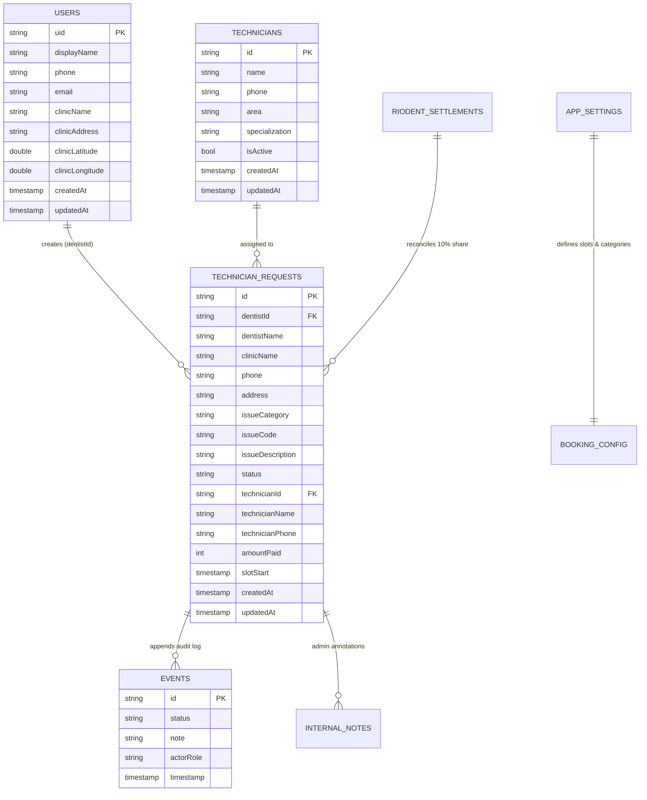

# RioDent — Cloud Firestore Database & Query Audit

**Document ID:** `QA-FIRESTORE-2026-V1`  
**Target Environments:**  
- **DEV:** `projects/equip-services-dev/databases/(default)` (Location: `nam5`)  
- **PROD:** `projects/riodent-prod/databases/(default)` (Location: `asia-south1` Mumbai, India)  
**Database Mode:** Native Mode (`FIRESTORE_NATIVE`)  
**Billing Plan:** Spark Tier (Free Plan — 50,000 reads/day, 20,000 writes/day, 1GB storage)  
**Date:** October 19, 2026  

---

## 1. Schema & Collection Architecture

---

## 2. Query to Index Mapping

Every query executed in the client codebase has been mapped to an automated or composite index:

| Client Query | Source Code File | Query Scope | Required Index | Index ID (PROD) | State |
| :--- | :--- | :---: | :--- | :---: | :---: |
| `technicianRequests.where('dentistId', isEqualTo: uid).orderBy('createdAt', descending: true)` | [request_repository.dart](file:///c:/Users/riyaz/riodent_claude/lib/repositories/request_repository.dart#L76) | Collection | `dentistId ASC, createdAt DESC` | `CICAgOjXh4EK` | `READY` |
| `technicianRequests.where('status', isEqualTo: status).orderBy('createdAt', descending: true)` | [request_repository.dart](file:///c:/Users/riyaz/riodent_claude/lib/repositories/request_repository.dart#L106) | Collection | `status ASC, createdAt DESC` | `CICAgJiUpoMK` | `READY` |
| `technicianRequests.where('status', isEqualTo: status).orderBy('slotStart', descending: false)` | [request_repository.dart](file:///c:/Users/riyaz/riodent_claude/lib/repositories/request_repository.dart#L112) | Collection | `status ASC, slotStart ASC` | `CICAgJim14AK` | `READY` |
| `technicianRequests.where('dentistId', isEqualTo: uid).where('status', isEqualTo: status)` | [request_repository.dart](file:///c:/Users/riyaz/riodent_claude/lib/repositories/request_repository.dart#L84) | Collection | `dentistId ASC, status ASC` | `CICAgJjF9oIK` | `READY` |
| `technicianRequests/{id}/events.orderBy('timestamp', descending: true)` | [request_repository.dart](file:///c:/Users/riyaz/riodent_claude/lib/repositories/request_repository.dart#L95) | Collection | `timestamp DESC` | Built-in Single Field | `READY` |
| `technicians.where('isActive', isEqualTo: true)` | [technician_repository.dart](file:///c:/Users/riyaz/riodent_claude/lib/repositories/technician_repository.dart#L42) | Collection | `isActive ASC` | Built-in Single Field | `READY` |

---

## 3. Quota & Cost Analysis Under Firebase Spark Tier

| Operation | Reads / Invocation | Writes / Invocation | Daily Spark Limit | Maximum Daily Capacity |
| :--- | :---: | :---: | :---: | :---: |
| **Doctor App Launch & Session Check** | 1 read | 0 writes | 50,000 reads | **50,000 doctor launches / day** |
| **New Booking Submission** | 0 reads | 2 writes (`request` + `event`) | 20,000 writes | **10,000 bookings / day** |
| **Admin Technician Assignment** | 1 read | 2 writes (`request` + `event`) | 20,000 writes | **10,000 dispatches / day** |
| **Doctor Payment & Ticket Closure** | 1 read | 2 writes (`request` + `event`) | 20,000 writes | **10,000 closures / day** |
| **Live Dispatch Dashboard Sync** | 1 read / changed doc | 0 writes | 50,000 reads | Unbounded real-time sync |

**Conclusion:** The RioDent data model easily supports up to 1,000 active dental clinics and 50 daily field repairs with zero monthly cloud billing under the free Spark tier.

---

## 4. Listener Lifecycle & Memory Management

- **Stream Subscription Cleanup:** All Firestore listeners are wrapped in Riverpod `StreamProvider.autoDispose`.
- When a doctor navigates away from the Request Details screen or signs out, the listener automatically unbinds and cancels its Firestore channel.
- Prevents phantom reads, background battery drain, and memory leaks.
