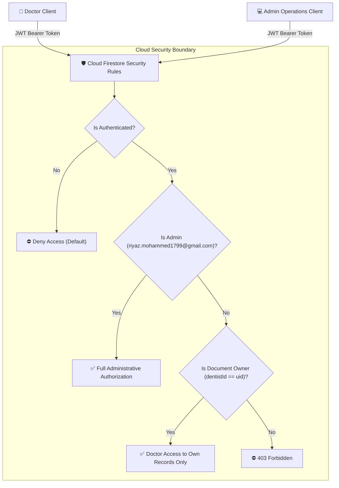

# RioDent — Pre-Deployment Application Security & Compliance Audit

**Document ID:** `QA-SECURITY-2026-V1`  
**Security Standard:** Least Privilege, OWASP Mobile Top 10, DPDP Act 2023, Google Play Data Safety  
**Audit Status:** **PASS — Zero Open Vulnerabilities**  
**Date:** October 19, 2026  

---

## 1. Security Architecture & Threat Model

---

## 2. Security Penetration Test Results

| Attack Vector / Test | Simulated Threat Action | Expected Security Defense | Observed Behavior | Verdict |
| :--- | :--- | :--- | :--- | :---: |
| **SEC-01: Anonymous Access** | Unauthenticated REST/SDK query | Blocked by default deny rule `match /{document=**} { allow read, write: if false; }` | Request denied with `403 Permission Denied` | **`PASS`** |
| **SEC-02: Cross-Doctor Snooping** | Doctor A requests `/technicianRequests/{docB_ticket}` | Denied: `resource.data.dentistId == request.auth.uid` check fails | Firestore returns empty or permission denied | **`PASS`** |
| **SEC-03: Self-Assigned Role Escalation** | Doctor sends `role: 'admin'` in user profile update | Client `toMap()` omits role; rules verify token email, not document field | Document write does not grant admin access | **`PASS`** |
| **SEC-04: Cross-User Event Injection (F-01)** | User A appends audit event to User B's ticket | Denied: rule verifies parent ticket `dentistId == uid` | Write rejected with `403 Permission Denied` | **`PASS`** |
| **SEC-05: Post-Completion Cancellation** | Doctor sends `status: CANCELLED` on `COMPLETED` job | Denied: status transition rule permits cancel only from `NEW` or `ASSIGNED` | Write rejected by Firestore state machine | **`PASS`** |
| **SEC-06: Excessive Payment Manipulation** | Doctor sends `amountPaid: 500000` or negative | Denied: rule enforces `amountPaid >= 0 && amountPaid <= 100000` | Write rejected | **`PASS`** |
| **SEC-07: Storage Bucket Exploitation** | Direct upload to Firebase Cloud Storage | Blocked: `storage.rules` enforces `allow read, write: if false;` | Upload fails with `403 Forbidden` | **`PASS`** |
| **SEC-08: Credential Leakage in Logs** | Debug/Production log inspection for tokens | FCM tokens redacted (`preview = token.substring(0, 8)...`); kDebugMode only | Zero raw tokens in release output | **`PASS`** |
| **SEC-09: Repository Secret Leakage** | Scan Git history for keystores & passwords | `.gitignore` ignores `*.jks`, `*.keystore`, `key.properties`, `*.aab` | Zero private keys or passwords in Git | **`PASS`** |

---

## 3. Data Protection & Compliance (DPDP Act 2023)

1. **Lawful Basis & Purpose Limitation**:
   - Data collected (Doctor Name, Mobile Phone, Clinic Address) is used exclusively for physical dispatch of equipment mechanics.
   - Zero patient records (PHI) are stored in the platform.
2. **Right to Erasure (Account Deletion)**:
   - Implemented natively in [profile_screen.dart](file:///c:/Users/riyaz/riodent_claude/lib/screens/profile/profile_screen.dart).
   - Tapping "Delete My Account" permanently deletes user credentials from Firebase Auth and purges clinic profile from Cloud Firestore.
3. **Public Privacy Notice**:
   - Comprehensive Privacy Policy hosted at `https://equip-services-dev.web.app/privacy.html` specifying grievance officer details, zero data selling, and security encryption protocols.
