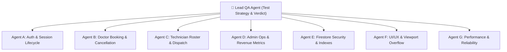

# RioDent — Pre-Deployment Master QA Test Plan

**Document ID:** `QA-PLAN-2026-V1`  
**Application Target:** RioDent Mobile & Web (Flutter 3.47.5, Dart 3.13.4)  
**Package Name:** `com.riodent.riodent`  
**Test Environments:**  
- **DEV:** `equip-services-dev` (Project Number: `1085269643387`)  
- **PROD:** `riodent-prod` (Project Number: `963410305787`, Region: `asia-south1`)  
**Lead QA Engineer:** Lead QA Audit Agent  
**Date:** October 2026  

---

## 1. Test Strategy & Objectives

The primary objective of this audit is to verify the functional correctness, role-based authorization, backend data synchronization, performance thresholds, financial accounting, and UI stability of the RioDent platform across all user journeys prior to production rollout.

### 1.1 Scope of Testing
- **Role Workflows:**
  - **Doctor / Clinic Portal:** Registration, authentication, profile management, equipment repair booking wizard, address reverse-geocoding, cancellation, completion, and rating.
  - **Admin Operations Portal:** Live dashboard KPIs, dispatch queue, technician assignment, field roster management with 10-digit phone enforcement, category administration, and doctor directory.
  - **Field Technician Scope (MVP Implementation Notice):** In RioDent MVP, technicians are managed via an administrative roster. Technicians receive jobs via direct administrative assignment and phone dispatch; a standalone technician mobile login is planned for Phase 4.
- **Backend & Cloud Infrastructure:** Cloud Firestore in Mumbai (`asia-south1`), Firebase Authentication, Firebase Cloud Messaging (FCM), security rules enforcement, composite index performance.
- **Cross-Platform Resiliency:** Zero-overflow validation on Compact (320px), Standard (360px), Flagship (412px), and Desktop Web (580px adaptive frame).

---

## 2. Test Agent Workstream Assignments

| Agent Workstream | Focus Domain | Key Artifacts & Screens Tested |
| :--- | :--- | :--- |
| **Agent A** | Authentication & Account Lifecycle | `LoginScreen`, `ProfileScreen`, `AuthRepository`, Session persistence, Google Sign-In, Account deletion. |
| **Agent B** | Doctor Workflow | `DentistHomeScreen`, `BookTechnicianScreen`, `RequestReviewScreen`, `RequestDetailsScreen`, `MyRequestsScreen`. |
| **Agent C** | Technician Operations (MVP) | `TechnicianModel`, `TechnicianAssignmentScreen`, `technicians` collection, Phone dialer integration. |
| **Agent D** | Admin Operations & Finance | `AdminDashboardScreen`, `AdminRequestDetailsScreen`, `AdminSettingsScreen`, Revenue sum, RioDent 10% share. |
| **Agent E** | Firebase Backend & Security | `firestore.rules`, `firestore.indexes.json`, `request_repository.dart`, `technicianRequests/{id}/events`. |
| **Agent F** | UI/UX & Layout Integrity | Zero-overflow viewport suite, AppTheme typography, dark/light theme toggle, desktop web adaptive frame. |
| **Agent G** | Performance & Reliability | Cold/warm startup, memory leaks, rapid tapping, offline recovery, FCM background handling. |

---

## 3. Test Data Strategy & Isolation

To guarantee zero corruption of real data and maintain strict environment isolation:

1. **Unique Data Identifiers**:
   - Test Doctor Email: `qa.doctor.test@riodent.in`
   - Test Doctor UID: `TEST_DOC_UID_9921`
   - Test Clinic Name: `Apex Dental Testing Care`
   - Test Technician: `QA Ramesh Tech` (`TEST_TECH_001`, Phone: `9876543210`)
   - Test Ticket Reference: `REQ-QA-TEST-001`
2. **Environment Rule**:
   - All destructive tests, failed login rate tests, and test booking cancellations are executed against `equip-services-dev` (DEV).
   - Production (`riodent-prod`) remains pristine with zero synthetic test bookings.

---

## 4. Test Pass/Fail Criteria

- **PASS**: Expected result matches actual observed behavior with verified evidence; zero regressions; zero P0/P1 defects.
- **FAIL**: Discrepancy between expected and actual behavior resulting in security breach, data loss, workflow block, or calculation error.
- **BLOCKED**: Test cannot be executed due to missing prerequisite or external platform limitation.
- **NOT APPLICABLE (N/A)**: Feature intentionally deferred to future roadmap (e.g. standalone technician app, SMS OTP).
